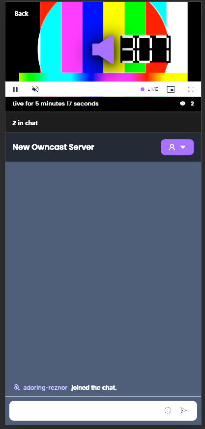

# Owncast-mobichat

Owncast plugins for phone and tablet viewing, starting with chat.

## Mobile Chat (`mobichat`)

When Owncast shows its mobile **Chat** button, this plugin opens a stacked watch page instead of the modal: stream on top, chat open underneath, plus a who's-here list.



| | |
| --- | --- |
| Plugin | [`mobichat/`](mobichat/) — version **0.1.0**, layout matches [`create-owncast-plugin`](https://github.com/owncast/plugin-sdk/tree/main/sdks/js/create-owncast-plugin/template) |
| Install notes | [`mobichat/INSTRUCTIONS.md`](mobichat/INSTRUCTIONS.md) (shipped inside the `.ocpkg`) |
| Layout notes | [`docs/mobile-chat.md`](docs/mobile-chat.md) |
| Screenshots | [`docs/screenshots/`](docs/screenshots/) |
| Release / catalog | [`docs/publishing.md`](docs/publishing.md) · [`CHANGELOG.md`](CHANGELOG.md) |
| Agent skills | [`AGENTS.md`](AGENTS.md) · `mobichat/.agents/skills/` (from Owncast plugin-sdk) |
| Local harness | [`dev/README.md`](dev/README.md) (Podman; optional) |

Requires **Owncast 0.3.0+**. Build with [`@owncast/plugin-sdk`](https://www.npmjs.com/package/@owncast/plugin-sdk).

```sh
cd mobichat
npm install
npm run release:check   # test + package + verify .ocpkg
```

Upload `mobichat.ocpkg` under **Admin → Plugins**, approve permissions, enable. To list it publicly, follow [`docs/publishing.md`](docs/publishing.md) (GitHub tag `v0.1.0` + [Owncast catalog submit](https://owncast.directory/plugins/submit)).

### What this repo does not ship

- No Owncast server binary or runtime data. Local Podman state lives under `dev/owncast/` and is gitignored.
- No reverse proxy. Plugin HTTP stays at `/plugins/mobichat/`.
- Built `.ocpkg` / `mobichat.js` / `node_modules` are gitignored; reviewers build from source.
